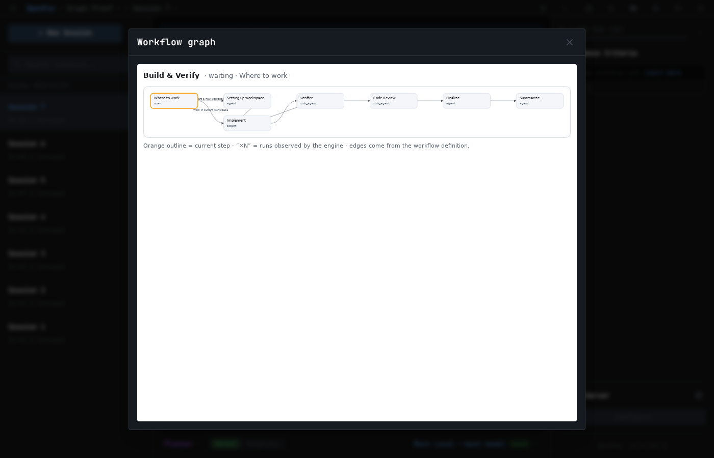
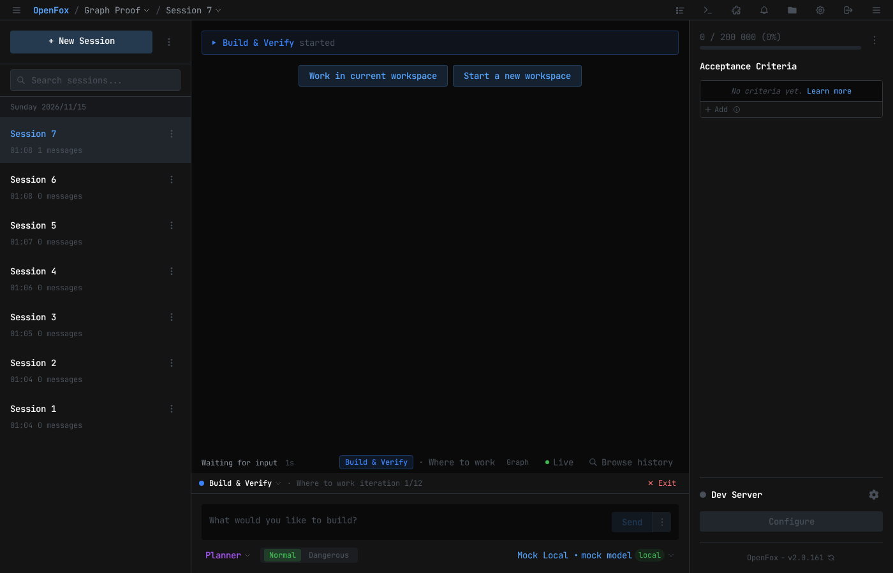
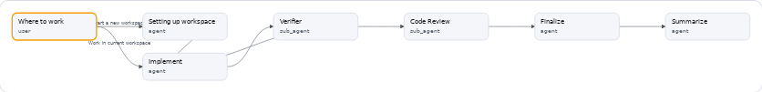
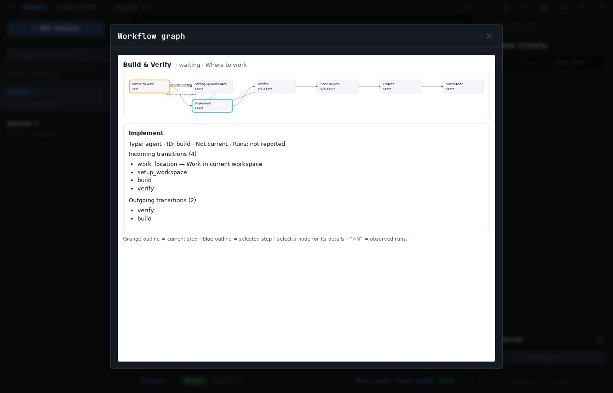
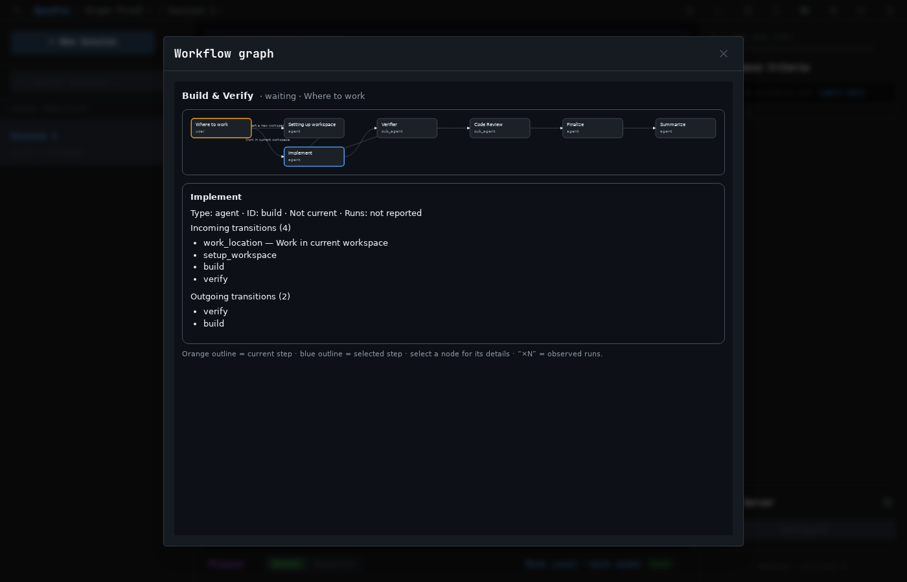

# OpenFox Workflow Visualizer

An **in-chat workflow visualizer for OpenFox**, shipped as a real `openfox/plugin` **API v2** package.

When a workflow runs it shows, **above the chat composer**, the workflow name, the current step and the engine's exact iteration counters — and a **"Graph" button that opens a real workflow diagram** (steps, transitions, current-step highlight, per-step run counts) rendered as SVG inside a plugin iframe panel. No React patching, no DOM hacking, no monkey patching.



> Status: **v0.2.0 — standalone plugin implementation.** The target user experience is the integrated, hover-accessible workflow graph demonstrated in the [reference screenshot](https://github.com/theshwal/openfox/blob/feat/workflow-visualizer-native/docs/images/workflow-visualizer.png). That image depicts a native prototype, **not** the current plugin UI. The plugin must reach this design through supported extension APIs, not an upstream core change.
---

## What it does

1. **Composer bar** (`composer.top` zone, `registerUiComponent` + RPC content source refreshed every 1.5 s):
   `● Build & Verify · Where to work · iteration 3/50` — plus a **Graph** button. Nothing is rendered when no workflow runs.
2. **Graph panel** (`kind: 'iframe'`, `registerAsset` + `registerUiPanel`): an SVG diagram built from the **real workflow definition** — one node per step, one edge per transition (labels taken from the transition condition), the current step outlined in orange, and `×N` badges with the per-step run counts reported by the engine.
3. **Text panel** (`kind: 'declarative'`): the same facts as key/value + table, for environments where the iframe cannot reach the API.

Data comes exclusively from the **`workflow.execution.changed`** hook (engine truth) and from the host's own workflow endpoints. Nothing is synthesized.






### How the iframe gets its data (the part people get wrong)

The panel iframe is sandboxed (opaque origin), so relative URLs do not resolve. The working chain is:

1. The host opens `/api/plugins/<pluginId>/assets/src/graph.html?token=…&sessionId=…&projectId=…&workdir=…`.
2. `graph.html` derives the host origin from `location.href`, then calls **`POST /api/plugins/<pluginId>/rpc/getGraph`** with the token (`Authorization: Bearer` + `x-session-token`) to read the **engine-observed** execution for that session.
3. It then fetches **`GET /api/workflows/:id?scope=<scope>&workdir=…`** for the exact definition (steps + transitions). Note: `GET /api/workflows` returns *summaries only* — it has no `steps`.
4. The shared `src/graph.js` model sanitizes the definition (only ids, names, known step types, valid transitions and a `#rrggbb` colour survive) and lays it out; the DOM is built with `createElementNS` + `textContent` only — never `innerHTML`, never `eval`.

CORS works because the host enables `app.use(cors())` (`Access-Control-Allow-Origin: *`), and the token is sent as a header rather than a cookie.

---

## Compatibility

- **OpenFox ≥ 2.0.161** (`peerDependencies`), plugin **`apiVersion: 2`**, capabilities `ui`, `hooks`, `rpc`, `assets`.
- Verified against a locally built OpenFox `develop` @ `0694574`: plugin loaded (`loaded: true`), enabled/disabled/uninstalled through the API, and the graph rendered end-to-end in real Chromium.
- Uses only documented contributions: `registerHook`, `registerRpc`, `registerUiComponent`, `registerUiPanel`, `registerAsset`.

## Installation

**Settings → Plugins → Install from GitHub** →

```
https://github.com/theshwal/openfox-workflow-visualizer
```

Then enable the plugin and start a workflow; click **Graph** in the bar above the composer.

Local development:

```bash
git clone https://github.com/theshwal/openfox-workflow-visualizer
curl -X POST http://localhost:<port>/api/plugins/install \
  -H 'content-type: application/json' \
  -d '{"path":"/absolute/path/to/openfox-workflow-visualizer"}'
```

> Do **not** use `hub_install`: the Community Hub registry indexes workflow/agent/skill/MCP **packs**, not plugin packages.

## Tests

```bash
npm install
npm test          # 37 unit tests, no host required
npm pack --dry-run
```

Coverage: registration (zone, RPCs, hook, assets, panels), hook→RPC integration, **exact scope resolution** (project > user > builtin), per-session isolation, late-event rejection from a replaced execution, empty states, counter formatting (cap, cumulative total, singular), **graph model** (nodes, edges from `when/goto` and `to`, unknown-target rejection, unreachable steps, field sanitization, invalid colour rejection, deterministic layout), and "never invent data".

Real-environment verification (isolated OpenFox instance, mock LLM, in-memory DB):

- `install` → `loaded: true`, `version 0.2.0`, capabilities `['ui','hooks','rpc','assets']`; `disable`/`enable`/`uninstall` HTTP 200.
- Chromium (Playwright): workflow launched from chat → plugin bar appeared → **Graph** clicked → iframe rendered `svg[role="group"]` with **7 nodes, 10 edges**, `aria-label="Workflow Build & Verify: 7 steps, current step Where to work"`, current node `work_location` marked `.current`; clicking the `build` node opened the inspector with its 4 incoming and 2 outgoing transitions. Screenshots: `docs/plugin-graph-panel.png`, `docs/plugin-graph.svg.png`, `docs/plugin-step-inspector.png`.

## Known limits (honest)

| Limit | Detail |
| --- | --- |
| Counter may be empty at the very first event | Some events (e.g. workflow start / first user pause) carry no `iterations`; the bar fills in at the next step event. |
| Graph appears once the run is known | The cache lives in the plugin process; after a host restart the bar and graph repopulate on the next `workflow.execution.changed`. No public "read current execution" API exists for plugins. |
| Asset paths are plugin-root relative | `registerAsset('src/graph.html')` — the route joins the path with the plugin root, so a bare `graph.html` 404s. |
| `reinstall` does not reload changed source | Use **uninstall → install** to pick up code changes. |
| Step details intentionally limited | Clicking a graph node shows its type, observed runs, active state and incoming/outgoing transitions; agent prompts and outputs are intentionally not exposed. |

## Privacy & security

- **No network calls to third parties**, no telemetry, no analytics, no remote code.
- The token from the panel URL is used only for same-host requests and is **never rendered, logged or persisted**.
- Rendering is declarative (host renderer) or `createElementNS` + `textContent`; workflow data is sanitized field-by-field before it reaches the DOM.
- Least privilege: `ui`, `hooks`, `rpc`, `assets` only. No filesystem access, no tools, no shell.

## Architecture

```
src/index.js    register(registry): hook, 3 RPCs, composer.top component, 2 panels, 2 assets
src/state.js    per-session cache + declarative view builders (host-free, unit-tested)
src/graph.js    definition sanitization + layered layout (host-free, unit-tested)
src/graph.html  iframe panel: RPC + definition fetch, SVG rendering
```

## Roadmap

- [x] Click or keyboard-select a node to inspect safe step metadata and transitions.
- [ ] Optional agent/output inspector with explicit host permissions and redaction.
- [ ] Restore state after a host reload once a read API exists.
- [ ] Publish as a standalone plugin in the Community Hub's related-plugins section (docs proposal pending).
- [ ] Match the integrated hover/graph experience from the reference screenshot using plugin extension points where possible.
- [ ] Optional completion notification.

## Plugin-only architecture

This project is the sole implementation and distribution target. No changes to the OpenFox core are planned or required for the current release. The reference screenshot from an earlier native prototype documents desired UX, not a dependency or a claim that the current iframe matches it. New work belongs in this plugin; compatibility limitations should be documented explicitly rather than silently shifting development upstream.

## Contributing

Issues and PRs welcome. Keep the plugin dependency-free at runtime (ESM only), add a test for every behaviour change, and never widen capabilities without documenting why.

## License

MIT — see [LICENSE](LICENSE).
